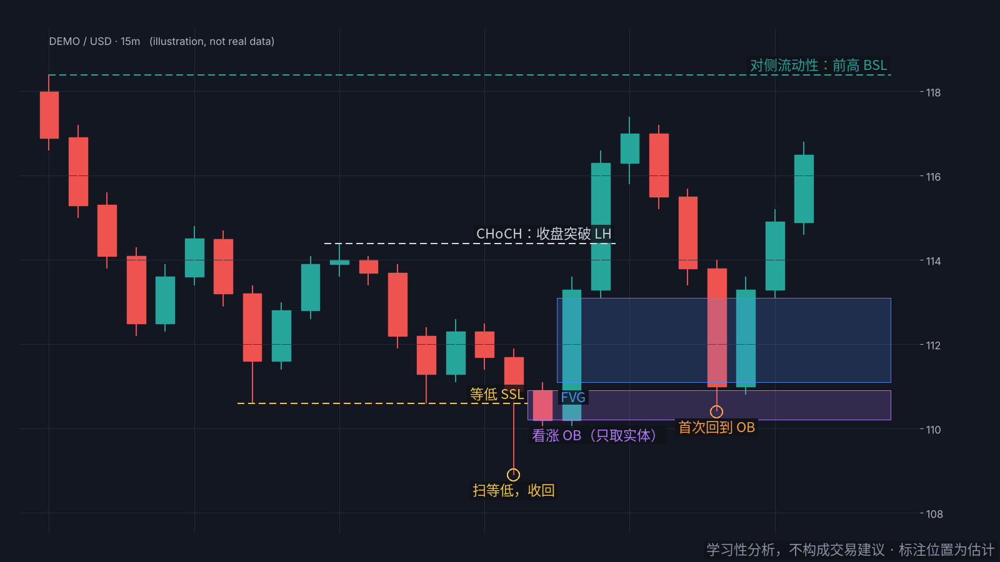

# SMC AI Tutor

English ｜ [中文](README.md)

> **A complete Smart Money Concepts (SMC) curriculum packaged as instructions any AI assistant can run. Upload one file and your AI becomes a one-on-one SMC tutor.**
> **把一整套 SMC 知识做成 AI 能直接执行的教学指令，上传给任意 AI 助手，它就会变成你的一对一 SMC 教练。**
>
> Guided lessons · Q&A · quizzes · diagrams · screenshot annotation · your own notes as memory

**Learn to read liquidity hunts — and stop being the liquidity.**


## What it is, and what it isn't

This is a **study aid**. It helps you connect SMC concepts and understand the logic behind some market behavior: why price so often "sweeps" an obvious high or low before moving, or why a breakout snaps right back.

It **cannot replace your own depth of thinking or independent judgment**. The AI can explain, draw and quiz, but it only sees what you show it, and it makes mistakes. Real skill comes from marking up charts yourself, testing, reviewing and correcting, over and over.

> For education only. Not investment advice. See the [disclaimer](#disclaimer).

> **Language note:** the source material is written in Chinese. The tutor replies in the language you use, so just send "start" in English and it will teach in English.

---

## Quick start

### Option 1: any AI assistant (recommended)

Works with ChatGPT, Claude, Gemini, DeepSeek, Doubao, Kimi and others.

1. Download [`prompt/SMC-AI-Tutor.md`](prompt/SMC-AI-Tutor.md)
2. Start a new chat and attach the file (or paste it in full)
3. Send **"start"**

The tutor asks five questions at once: your level, your market, how you want to learn, **how you want to see charts**, and **whether to turn on the notes memory**. Then it switches to the matching mode.

> If your AI can't read the whole file, or clearly ignores the instructions, use the lite version [`prompt/SMC-AI-Tutor-lite.md`](prompt/SMC-AI-Tutor-lite.md). It drops the ASCII charts for the advanced models and the annotation code. Everything else is the same.

### Option 2: Claude Skill (Claude Code / Claude apps)

[`skills/smc-learning/`](skills/smc-learning/) is a standard Skill folder. It loads reference files on demand and ships with every SVG diagram.

- **Claude Code**: copy `skills/smc-learning` into `~/.claude/skills/`, then ask any SMC question
- **Claude apps**: zip the `skills/smc-learning` folder and upload it in your Skills settings

### Option 3: read it yourself

- [`docs/handbook.md`](docs/handbook.md): the full handbook, with diagrams embedded
- [`docs/entry-models.md`](docs/entry-models.md): advanced concepts and entry models, 24 diagrams
- [`docs/distillation.md`](docs/distillation.md): a dense summary for quick reference, or to give an AI as a knowledge base

---

## Features

### 1. Charts in every mainstream AI

At the start, the tutor checks what its environment can actually render and only offers those options:

| Format | Where it works |
|---|---|
| SVG / HTML diagrams | AIs with a canvas, artifacts or another preview feature |
| Python charts | AIs that can run code |
| ASCII charts | Any AI, even plain text |
| Text and tables | Quick checks |
| TradingView drawing steps | When you want to draw on your own chart |

Process content (the entry sequence, the 11-step checklist) can also be shown as Mermaid flowcharts where supported.

### 2. Screenshot annotation

Send a chart screenshot and the tutor follows a fixed procedure. It reads the chart, lists candidate key points with their location, reasoning and confidence, and checks each one against a checklist. **Anything that fails a check is not drawn**, and uncertain items are drawn dashed with a "?". Output options:

- **Drawn on your image**: AIs that can run code use the code in [`tools/annotate.py`](tools/annotate.py)
- **Annotator page**: any AI can output an annotation JSON. Open [`annotator/index.html`](annotator/index.html), drop in your screenshot, paste the JSON, **drag anything that's off**, and export a PNG. Everything runs locally in your browser; the image is never uploaded.
- **TradingView drawing steps** by price and time
- **A text table**

> AI-read positions on a screenshot are estimates and can be off by a few candles or a bit of price. The annotator's drag-to-fix is there for exactly that.

Click "Demo" in the annotator to see this example (synthetic data):



### 3. Notes memory: bring your own SMC understanding

Turn it on at the start, then:

- **Upload** your own notes (start the file with `<!-- my-smc -->`)
- **Add as you go**: say "note this: I mark OBs on the whole candle", and the tutor confirms and saves it
- **Export any time**: say "export my notes" to get a `my-smc.md` you can upload next time

**For any concept you cover, the tutor follows your definition.** The first time it does, it says "using your definition here; the default is …". Anything you don't cover falls back to the curriculum. If your definition carries obvious risk (for example, no stop loss), the tutor explains why but doesn't overwrite it.

Claude Skill users can put notes in [`skills/smc-learning/my-notes/`](skills/smc-learning/my-notes/), which loads at the start of each session; in Claude Code the tutor can also save there with your permission. Your own files in `my-notes/` are git-ignored by default.

---

## Curriculum

| Lesson | Topic |
|---|---|
| L0 | What SMC is and why price moves "strangely" |
| L1 | Market structure (HH / HL / LH / LL) |
| L2 | BOS / CHoCH / MSS |
| L3 | Liquidity and sweeps |
| L4 | Inducement |
| L5 | Displacement and fair value gaps (FVG) |
| L6 | Order blocks (OB) and POI. Body-only zones |
| L7 | Premium / discount |
| L8 | Triggers and entry sequence |
| L9 | Multi-timeframe analysis and the full workflow |
| L10 | Risk, execution and review (8-point trade plan) |
| L11 | Advanced: extra ICT concepts (Breaker, OTE, PO3, SMT) and 20 QM / supply-demand entry models, translated into SMC terms |

Plus **55 frequently asked questions**, a 20-question final quiz, a list of common mistakes, an 11-step analysis checklist and a review template.

**On conventions:** schools disagree on MSS, CISD, whether inducement is required for a valid BOS, and whether an OB covers the whole candle or only the body. The material states its own convention and the common alternatives.

**About the 【作者实战经验】 (author's experience) tag:** content with this tag, such as CISD, rejection-wick strength and the mindset mistakes, is the author's own lesson from personal trading. It is **not a standard SMC definition** and rests on a limited sample. The tutor says so whenever it uses this content.

## How accuracy is enforced

- **Diagrams are generated from data.** Every candle chart starts from explicit OHLC values, annotations are computed from that data, and logic assertions run before anything is drawn (an FVG needs C's low above A's high, a sweep needs a wick beyond the level and a close back inside, an OB must be the last opposite candle before displacement). If any check fails, the script stops instead of producing a wrong picture.
- **ASCII charts share the same data** and are checked so that higher points really sit on higher rows.
- **A pre-drawing checklist** is part of the tutor's instructions, and both the annotator and the annotation code reject self-contradictory annotations.

## Editing and rebuilding

Edit content in `skills/smc-learning/references/` (01–06, 08) and the tutor instructions in `tools/tutor_core.md`, then rebuild:

```bash
python3 tools/gen_diagrams.py                       # core diagrams (with assertions)
python3 tools/ob_poster.py                          # OB one-pager
python3 tools/gen_models.py                         # advanced / entry-model diagrams (with assertions)
python3 tools/gen_ascii.py                          # ASCII chart library 07 (with assertions)
python3 tools/gen_example.py                        # annotator demo chart and JSON (synthetic)
python3 tools/build.py                              # SKILL.md, prompt/, docs/
python3 tools/render.py diagrams/svg diagrams/png   # SVG → PNG (requires playwright)
python3 tools/render.py diagrams/models/svg diagrams/models/png
```

## Contributing

Issues and PRs are welcome for wrong definitions, unclear explanations or mislabeled diagrams. Please explain your reasoning, and write in your own words. **Do not paste text or screenshots from paid courses or books.**

## Sources

The content comes from the author's study notes, synthesis and trade reviews. All text is in the author's own words, and all diagrams are generated by scripts. Main sources: Jie Ge's SMC course (街哥, a well-known SMC trader on X), Frank Miller's *Smart Money Concepts: Unlocking the Path to High Probability Trading* (please buy the book), ICT (Michael J. Huddleston), a QM / supply-demand cheat sheet compiled by TRADER_ZHAO (used only for the list of entry models), and the author's own trade reviews (tagged 【作者实战经验】). Each section names its source with `> 出处：…`. See [SOURCES.md](SOURCES.md) for the full mapping.

## Disclaimer

- For learning only. This project gives no investment advice, trade signals or managed trading.
- Trading carries risk, and **no method guarantees profit**. Make your own decisions within your own risk tolerance.
- AI answers and screenshot annotations can be wrong. Treat the tutor as a study aid, not a signal service, and never as a substitute for your own judgment.
- Content tagged 【作者实战经验】 reflects one trader's experience, not a general rule.

## License

[CC BY-NC-SA 4.0](LICENSE). You may use, copy, adapt and share this project for free with attribution, and adaptations must use the same license. **Commercial use is not permitted**, including selling it or bundling it into paid courses or paid groups.
