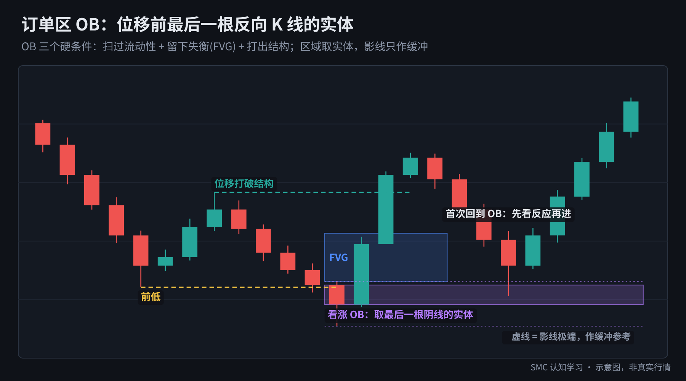
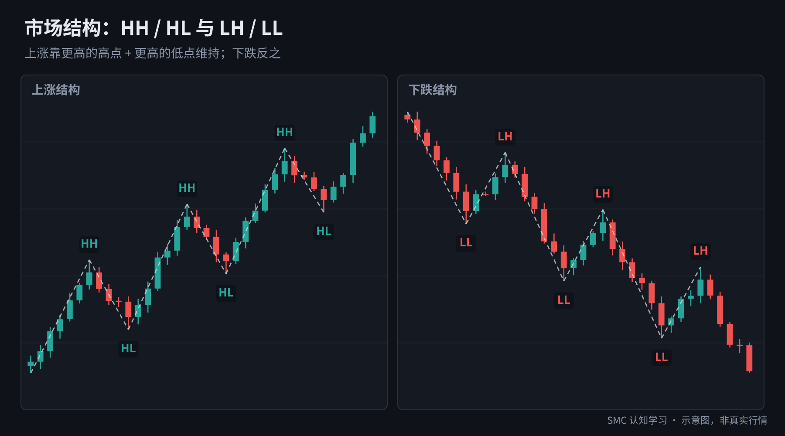
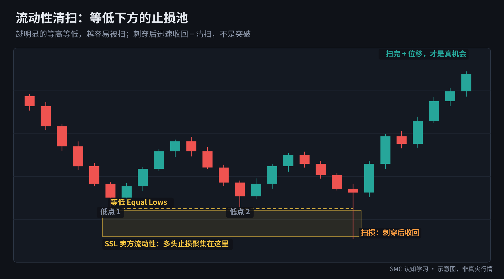
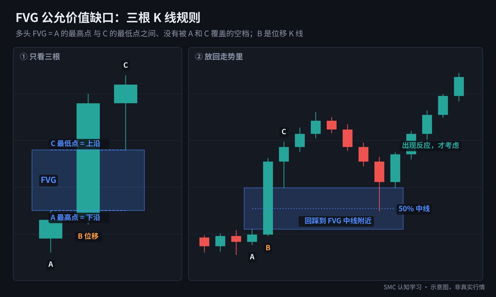
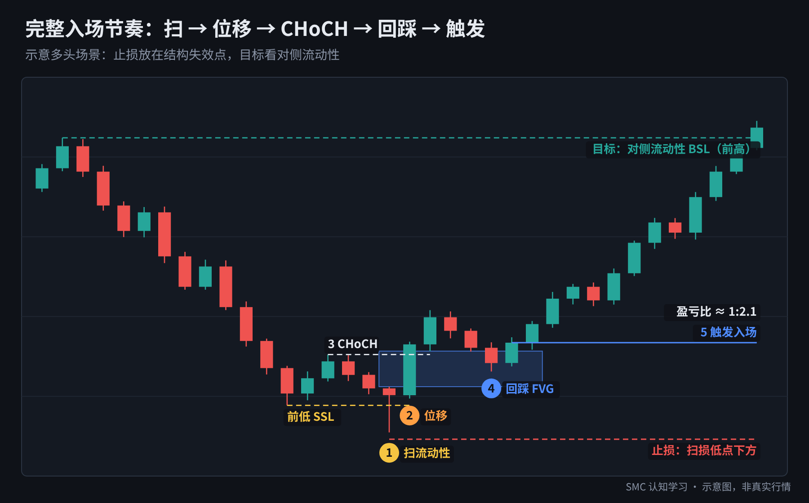

# SMC AI Tutor · 聪明钱概念 AI 教练

[English](README.en.md) ｜ 中文

把一整套 SMC（Smart Money Concepts，聪明钱概念）知识做成 **AI 能直接执行的教学指令**。上传给任意 AI 助手，它就会变成你的一对一 SMC 教练：按课程带学、随时答疑、出题检验、画 K 线示意图讲解、带你复盘图表。

**看懂流动性猎杀，不再做被扫的那一个。**



> 本项目只做学习用途，不构成任何投资建议。详见文末[免责声明](#免责声明)。

---

## 三种用法

### 1. 任意 AI 助手（推荐，零门槛）

适用于 ChatGPT、Claude、DeepSeek、豆包、Kimi、Gemini 等。

1. 下载 [`prompt/SMC-AI-Tutor.md`](prompt/SMC-AI-Tutor.md)
2. 新开一个对话，把文件作为附件上传（或全文粘贴）
3. 发送 **"开始"**

AI 会先问你三个问题（基础、市场、想怎么学），然后进入对应模式。

### 2. Claude Skill（Claude Code / Claude 应用）

[`skills/smc-learning/`](skills/smc-learning/) 是标准的 Skill 目录，按需读取参考文件，比单文件更省上下文。

- **Claude Code**：把 `skills/smc-learning` 复制到 `~/.claude/skills/`，之后直接问 SMC 相关问题即可触发
- **Claude 应用**：把 `skills/smc-learning` 文件夹压缩成 zip，在技能设置里上传

### 3. 自己读

- [`docs/handbook.md`](docs/handbook.md)：完整学习手册，示意图已嵌入正文
- [`docs/distillation.md`](docs/distillation.md)：高密度认知蒸馏，适合速查，也可以喂给 AI 当知识库

---

## AI 怎么讲一个概念

每个概念都按同一个节奏：

1. **一句话结论**
2. **生活比喻**
3. **配图**：能渲染图形的环境用 SVG 示意图，只能显示文字的环境自动换成字符图
4. **可检查的规则**
5. **常见误区**
6. **小练习 + 3 道过关题**：答对 2 题再进下一课

四种模式：**系统学习 / 答疑 / 测验 / 看图复盘**。

---

## 课程内容

| 课 | 主题 | 核心问题 |
|---|---|---|
| L0 | SMC 是什么 | 为什么价格会"奇怪地"走 |
| L1 | 市场结构 | 现在是涨、跌还是震荡 |
| L2 | BOS / CHoCH / MSS | 延续和转折怎么区分 |
| L3 | 流动性与清扫 | 止损池在哪，扫了还是真突破 |
| L4 | 诱导 Inducement | 哪个区域是用来被吃掉的 |
| L5 | 位移与 FVG | 什么样的推动才算数 |
| L6 | 订单区 OB 与 POI | OB 的三个硬条件，为什么只取实体 |
| L7 | Premium / Discount | 现在价格贵还是便宜 |
| L8 | 触发与入场 | 扫 → 位移 → CHoCH → 回踩 → 确认 |
| L9 | 多周期与完整流程 | 大周期定方向，小周期找触发，把一切串起来 |
| L10 | 风控、执行与复盘 | 止损、目标、八要素计划、复盘 |

另有 **49 个常见疑问与回答**、15 道综合测验、误区清单、十一步分析清单和复盘模板。

## 示意图

| | |
|---|---|
|  |  |
|  |  |

全部 12 张见 [`diagrams/`](diagrams/)。所有示意图都是程序生成的虚构走势，不是真实行情。

---

## 目录结构

```
smc-ai-tutor/
├── prompt/SMC-AI-Tutor.md      # 单文件 AI 指令（任意 AI 可用，自动生成）
├── skills/smc-learning/        # Claude Skill（内容源文件）
│   ├── SKILL.md
│   ├── references/             # 01 认知框架 … 05 画图规范
│   └── assets/diagrams/        # SVG 示意图
├── docs/
│   ├── handbook.md             # 学习手册（自动生成）
│   └── distillation.md         # 认知蒸馏
├── diagrams/svg | png          # 示意图
└── tools/                      # 生成脚本
```

**内容只改 `skills/smc-learning/references/`**，然后重新生成：

```bash
python3 tools/build.py                          # 生成 prompt/ 和 docs/handbook.md
python3 tools/gen_diagrams.py                   # 重新生成 SVG 示意图
python3 tools/ob_poster.py                      # 重新生成 OB 一图看懂
python3 tools/render.py diagrams/svg diagrams/png   # SVG 转 PNG（需要 playwright）
```

## 参与贡献

发现定义有误、讲解不清、示意图标错，欢迎提 Issue 或 PR。提交时请说明：

- 改的是哪个概念、原来怎么写、建议怎么改
- 理由（逻辑推导或公开资料来源）
- 请用自己的话写，**不要粘贴付费课程、书籍的原文或截图**

SMC 各流派对部分概念（如 OB 取实体还是整根、CISD 的定义）说法不一。本项目在文中写明了自己的口径，有不同意见欢迎讨论。

## 免责声明

- 本项目**仅用于学习交流**，不构成任何投资建议，不荐股、不喊单、不带单。
- 交易有风险，**任何方法都不能保证盈利**。请根据自身风险承受能力独立决策，盈亏自负。
- AI 的回答可能出错。请把它当作学习辅助，不要当作交易信号。

## 许可证

[CC BY-NC-SA 4.0](LICENSE)：

- ✅ 可以免费使用、复制、修改、二次分享
- ✅ 需要署名并注明修改
- ✅ 改编后的作品须以相同许可证发布
- ❌ **禁止任何商业用途**，包括打包出售、做成付费课程或付费群资料
