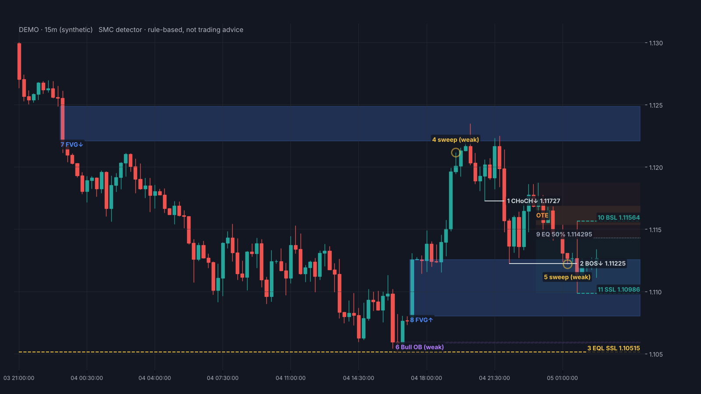

# SMC AI Tutor · 聪明钱概念 AI 教练

[English](README.en.md) ｜ 中文

> **把一整套 SMC 知识做成 AI 能直接执行的教学指令。上传给任意 AI 助手，它就会变成你的一对一 SMC 教练。**
> **A complete Smart Money Concepts curriculum packaged as instructions any AI assistant can run: upload one file and get a one-on-one SMC tutor.**
>
> 按课程带学 · 随时答疑 · 出题检验 · 画图讲解 · K 线数据精确识别 · 截图标注 · 记住你自己的认知
> Guided lessons · Q&A · quizzes · diagrams · exact detection from candle data · screenshot annotation · your own notes as memory

**看懂流动性猎杀，不再做被扫的那一个。 · Learn to read liquidity hunts — and stop being the liquidity.**


## 先说清楚：它是什么，不是什么

这是一个**辅助学习**的工具：帮你把 SMC 的概念串起来，更好地理解一些市场行为背后的逻辑，比如价格为什么总在明显的高低点附近"扫一下"再走，为什么突破之后又迅速收回。

它**替代不了你自己思考的深度和独立判断**。AI 会讲、会画、会出题，但它看不到你没给它的信息，也会出错。真正的能力，来自你自己在图上一遍遍标注、验证、复盘、修正。

> 本项目只做学习用途，不构成任何投资建议。详见文末[免责声明](#免责声明)。

---

## 快速开始

### 方式一：任意 AI 助手（推荐）

适用于 ChatGPT、Claude、Gemini、DeepSeek、豆包、Kimi 等。

1. 下载 [`prompt/SMC-AI-Tutor.md`](prompt/SMC-AI-Tutor.md)
2. 新开一个对话，把文件作为附件上传（或全文粘贴）
3. 发送 **"开始"**（英文发 "start"，AI 会用英文教）

AI 会一次问你五个问题：**基础、市场、想怎么学、想用哪种方式看图、要不要启用认知记忆区**，然后进入对应模式。

> AI 读不全大文件、或者回答明显没按指令走时，换用精简版 [`prompt/SMC-AI-Tutor-lite.md`](prompt/SMC-AI-Tutor-lite.md)（去掉了进阶模型的字符图、标注代码和识别代码，其他内容相同；识别改用在线识别器）。

### 方式二：Claude Skill（Claude Code / Claude 应用）

[`skills/smc-learning/`](skills/smc-learning/) 是标准的 Skill 目录，按需读取参考文件，比单文件更省上下文，还自带全部 SVG 示意图。

- **Claude Code**：把 `skills/smc-learning` 复制到 `~/.claude/skills/`，之后直接问 SMC 相关问题即可触发
- **Claude 应用**：把 `skills/smc-learning` 文件夹压缩成 zip，在技能设置里上传

### 方式三：不用 AI，自己读

- [`docs/handbook.md`](docs/handbook.md)：完整学习手册，示意图已嵌入正文
- [`docs/entry-models.md`](docs/entry-models.md)：进阶概念与入场模型图鉴，24 张图解
- [`docs/distillation.md`](docs/distillation.md)：高密度认知蒸馏，适合速查，也可以喂给 AI 当知识库

---

## 主要功能

### 1. 主流 AI 都能看到图

开场时 AI 先判断自己所在环境能做到什么，只给你列出**真的能用**的展示方式：

| 展示方式 | 适合的环境 |
|---|---|
| 图形示意图（SVG / HTML） | 有画布、Artifact、Canvas 等可视化功能的 AI |
| Python 画图 | 能运行代码的 AI |
| 字符图 | 任何 AI，纯文字也能看 |
| 纯文字 + 表格 | 想快速核对时 |
| TradingView 画线指引 | 想在自己的图表上动手画时 |

流程类内容（入场节奏、十一步清单）在支持的环境里还可以用 Mermaid 流程图。

### 2. 精确标注：用 K 线数据，由程序识别、AI 讲解

只靠提示词让 AI 看截图画线，精度上不去：偏几根 K 线、把重叠看成缺口、分不清收盘在关键位里面还是外面，都很常见。所以真实行情的标注**交给程序算，AI 只负责讲解**：

1. 导出这段行情的 K 线数据（MT5 / MT4 / TradingView 导出的 CSV，或任何带开高低收的表格；加密货币可以直接从币安拉取）
2. 打开[在线识别器](https://pruettlazaro143-a11y.github.io/smc-ai-tutor/detector/)（或离线打开 [`detector/index.html`](detector/index.html)），放入数据：程序按教程规则算出结构（BOS / CHoCH）、等高等低、清扫、FVG、OB（只取实体，且必须同时满足清扫 + FVG + 结构突破）、Premium / Discount 和 OTE，画在图上
3. **每一项都分强弱**：比如 OB 要求那根反向 K 线实体饱满、之后被暴力拉开，十字星硬套上定义的会标"弱"（虚线），并写明为什么偏重低、容易失效。FVG 看宽度和有没有结构配合，清扫看越过深度和扫完有没有反应，结构突破看收盘越过多少、有没有位移。不为了找指标而标指标
4. 点"复制报告给 AI"，粘贴给加载了教程的 AI，它按报告逐项讲解，**不改动程序识别的位置和价格**

能运行代码的 AI（如 ChatGPT 的数据分析、Claude）会直接运行自带的 [`tools/smc_detect.py`](tools/smc_detect.py)，你上传 CSV 就能拿到标注图和讲解。数据只在你的浏览器或 AI 的代码环境里处理。



*（虚构走势。图上每个标注前的编号对应报告条目。）*

识别规则逐条对应教程定义，写在 [`references/09-数据识别引擎.md`](skills/smc-learning/references/09-数据识别引擎.md)。程序不判断诱导、多周期方向、消息面和入场触发，这些仍然要你自己核对。

### 3. 截图标注：只有截图时的粗略参考

拿不到数据时，AI 会按固定流程来：先读图、列出候选关键点（位置、依据、把握程度），再逐项核对，**不满足条件的不标**，拿不准的标成虚线加"?"。标注有四种输出：

- **直接画在原图上**：能运行代码的 AI 用 [`tools/annotate.py`](tools/annotate.py) 的代码画好发给你
- **标注器网页**：任何 AI 都能输出一段标注 JSON，用[在线标注器](https://pruettlazaro143-a11y.github.io/smc-ai-tutor/annotator/)（或离线打开 [`annotator/index.html`](annotator/index.html)）放入截图、粘贴 JSON，就能看到标注，**位置不准可以直接拖动修正**，再导出 PNG（全部在浏览器本地完成，图片不上传）
- **TradingView 画线指引**：按价格和时间告诉你在哪画线、画框
- **文字表格**

> AI 从截图里读位置是**估计**，可能偏几根 K 线或一点价格，只能当粗略参考。标注器的拖动校正就是为这个准备的；要精确结果，请用上面的数据识别。

打开标注器点"看示例"，可以看到下面这张演示（虚构走势）：


### 4. 认知记忆区：加入你自己的 SMC 理解

学的课程、书不同，口径难免有出入。开场时选择启用，你可以：

- **直接上传**自己的笔记或蒸馏文件（开头加一行 `<!-- my-smc -->`）
- **边学边记**：跟 AI 说"记下：我的 OB 取整根 K 线"，它会确认后记入
- **随时导出**：说"导出我的认知"，得到一份 `my-smc.md`，下次和指令一起上传

同一概念 **AI 会以你的口径为准**，第一次用到时标注"这里按你的口径……教程默认说法是……"；你没写的部分照用教程内容；你的口径有明显风险（比如不设止损）时，AI 会说明理由，但不强改。

Claude Skill 用户把笔记放进 [`skills/smc-learning/my-notes/`](skills/smc-learning/my-notes/)，开场自动读取；在 Claude Code 里 AI 还能经你同意直接写进这个文件夹。想合并成一个文件，按 [`_template.md`](skills/smc-learning/my-notes/_template.md) 的编号写好，运行 `python3 tools/build.py` 即可。`my-notes/` 里你自己的文件默认不会提交到 Git。

---

## 课程内容

| 课 | 主题 | 核心问题 |
|---|---|---|
| L0 | SMC 是什么 | 为什么价格会"奇怪地"走 |
| L1 | 市场结构 | 现在是涨、跌还是震荡 |
| L2 | BOS / CHoCH / MSS | 延续和转折怎么区分 |
| L3 | 流动性与清扫 | 止损池在哪，扫了还是真突破 |
| L4 | 诱导 Inducement | 哪个区域是用来被吃掉的 |
| L5 | 位移与 FVG | 什么样的推动才算数 |
| L6 | 订单区 OB 与 POI | OB 的三个硬条件，为什么只取实体 |
| L7 | Premium / Discount | 现在价格贵还是便宜 |
| L8 | 触发与入场 | 扫 → 位移 → CHoCH → 回踩 → 确认 |
| L9 | 多周期与完整流程 | 大周期定方向，小周期找触发，把一切串起来 |
| L10 | 风控、执行与复盘 | 止损、目标、八要素计划、复盘 |
| L11 | 进阶：ICT 补充概念与入场模型 | Breaker、OTE、PO3、SMT，以及 QM / 假突破等 20 个入场模型在 SMC 里对应什么 |

另有 **55 个常见疑问与回答**、20 道综合测验、误区清单、十一步分析清单和复盘模板。

**关于口径**：MSS、CISD、诱导是否为 BOS 的必要条件、OB 取实体还是整根等，各流派说法不同。教材写明了本项目采用的口径，也写明了别处的常见说法。

**关于【作者实战经验】**：标有这个标记的部分（如 CISD、拒绝针强弱、心态层误区），是作者在自己交易中遇到具体情况后总结的经验，**不是 SMC 的通用定义**，样本有限。AI 讲到这些内容时会主动说明，请谨慎理解，先在自己的图上验证。

## 准确性是怎么保证的

- **示意图由数据生成**：每张 K 线图都先写好每根 K 线的开高低收，标注从数据计算出来，生成前跑一遍逻辑断言（例如 FVG 必须满足 C 的最低点高于 A 的最高点、清扫必须影线越过且实体收回、OB 必须是位移前最后一根反向 K 线）。任何一条不满足，脚本直接报错，不会出图。
- **字符图同源**：字符图库由同一套数据生成，并检查"该高的点在更高的行"，保证文字版和图形版说的是一回事。
- **真实行情由程序识别**：识别器的每条规则对应教程定义。`tools/test_detect.py` 做四类检查：示例图里人工确认过的每一项必须原样识别出来；在 60 组随机走势上把识别出的每一项按定义独立重算（共约 6000 项）；Python 版和网页版对 360 个不同格式的数据文件结果逐项一致；网页报告和 Python 版一字不差。
- **标注前核对清单**：AI 在画任何图、标任何截图之前，都要逐项过一遍核对清单；标注器和标注代码也会拒绝明显矛盾的标注。
- 发现错误欢迎提 Issue，见[参与贡献](#参与贡献)。

## 示意图

| | |
|---|---|
|  |  |
|  |  |
|  |  |

基础概念 12 张见 [`diagrams/svg`](diagrams/svg/)，进阶概念与入场模型 24 张见 [`diagrams/models`](diagrams/models/)。所有示意图都是程序生成的虚构走势，不是真实行情。

---

## 目录结构

```
smc-ai-tutor/
├── prompt/
│   ├── SMC-AI-Tutor.md         # 单文件 AI 指令（任意 AI 可用，自动生成）
│   └── SMC-AI-Tutor-lite.md    # 精简版（自动生成）
├── skills/smc-learning/        # Claude Skill
│   ├── SKILL.md                # 教练指令（自动生成）
│   ├── references/             # 01 认知框架 … 09 数据识别引擎（内容源文件）
│   ├── scripts/smc_detect.py   # 识别程序（自动复制）
│   ├── assets/                 # SVG 示意图
│   └── my-notes/               # 你自己的 SMC 认知（默认不提交）
├── detector/                   # K 线数据识别器（网页版引擎 + 页面，浏览器本地运行）
├── annotator/index.html        # 截图标注器（浏览器本地运行）
├── docs/                       # 手册、图鉴、认知蒸馏
├── diagrams/                   # 全部示意图 SVG / PNG
├── tools/                      # 生成与校验脚本
└── SOURCES.md                  # 出处对照
```

**内容只改 `skills/smc-learning/references/`（01–06、08、09）和 `tools/tutor_core.md`（教练指令）**；识别规则改 `tools/smc_detect.py` 时，`detector/smc-detect.js` 要同步改，再跑测试确认两边一致，然后重新生成：

```bash
python3 tools/gen_diagrams.py                       # 基础示意图（带逻辑断言）
python3 tools/ob_poster.py                          # OB 一图看懂
python3 tools/gen_models.py                         # 进阶与入场模型图（带逻辑断言）
python3 tools/gen_ascii.py                          # 字符图库 07（带逻辑断言）
python3 tools/gen_example.py                        # 标注器示例图与示例 JSON（虚构数据）
python3 tools/gen_detector_demo.py                  # 识别器演示数据与效果图（虚构数据）
python3 tools/test_detect.py                        # 识别引擎测试（需要 Node.js；网页测试需要 playwright）
python3 tools/build.py                              # SKILL.md、prompt/、docs/
python3 tools/render.py diagrams/svg diagrams/png   # SVG 转 PNG（需要 playwright）
python3 tools/render.py diagrams/models/svg diagrams/models/png
```

## 参与贡献

发现定义有误、讲解不清、示意图标错，欢迎提 Issue 或 PR。提交时请说明：

- 改的是哪个概念、原来怎么写、建议怎么改
- 理由（逻辑推导或公开资料来源）
- 请用自己的话写，**不要粘贴付费课程、书籍的原文或截图**

## 出处

内容由作者学习、整理和实战复盘而来，文字全部用自己的话重写，示意图全部由脚本生成。主要来源：

- **街哥 SMC 系统教程**（街哥是 X 上知名的 SMC 交易员）
- **Frank Miller《Smart Money Concepts: Unlocking the Path to High Probability Trading》**（推荐购买正版）
- **ICT**（Inner Circle Trader，Michael J. Huddleston）的公开教学概念
- **《ICT 机构价格行为备忘单》**（TRADER_ZHAO 整理）：进阶入场模型的清单
- **作者实战复盘**：标有【作者实战经验】的部分

正文每个小节用 `> 出处：…` 标明来源。完整对照见 [SOURCES.md](SOURCES.md)。

## 免责声明

- 本项目**仅用于学习交流**，不构成任何投资建议，不荐股、不喊单、不带单。
- 交易有风险，**任何方法都不能保证盈利**。请根据自身风险承受能力独立决策，盈亏自负。
- AI 的回答和截图标注可能出错。请把它当作学习辅助，不要当作交易信号，更不要用它代替自己的判断。
- 识别器只按固定规则识别形态，识别出 OB、FVG 不代表价格会在那里反应。它不是交易信号，也不是自动交易程序（EA）。
- 标有【作者实战经验】的内容是个人经验总结，不代表普遍规律。

## 许可证

[CC BY-NC-SA 4.0](LICENSE)：

- ✅ 可以免费使用、复制、修改、二次分享
- ✅ 需要署名并注明修改
- ✅ 改编后的作品须以相同许可证发布
- ❌ **禁止任何商业用途**，包括打包出售、做成付费课程或付费群资料
