# SMC 进阶概念与入场模型图鉴

> 本文件由 `tools/build.py` 自动生成，可直接阅读，不需要 AI。建议先掌握 SMC 基础（结构、流动性、FVG、OB、区间、触发）再看。
>
> 分两部分：
> - **A. ICT 补充概念**：ICT 体系里常见、前面没展开的概念
> - **B. QM / 供需入场模型图鉴**：另一派（QM 卡西莫多 / 供需区）常用的入场形态，用 SMC 的语言解释它们
>

---

## A. ICT 补充概念

> 出处：ICT（Inner Circle Trader，Michael J. Huddleston）公开教学中的概念，结合公开资料用自己的话整理

### A1. 破坏块（Breaker Block）


**一句话**：一个**失效的 OB**，在扫过流动性、结构反转之后，变成反方向的反应区。

**看涨 Breaker 的形成顺序**：
1. 价格先形成一个低点 L，反弹出一个高点 H
2. 从 H 开始下跌，**跌破 L**，扫掉 L 下方的卖方流动性
3. 随后强势上涨，**实体收盘突破 H**（结构反转，MSS）
4. H 处、下跌开始前的那段上涨 K 线（原本是看跌 OB）被突破失效 → 它成了**看涨 Breaker**
5. 价格回落到这里，观察是否获得支撑

**画法分歧**：有的教材取 H 处的上涨 K 线，有的取失败那段下跌里的 K 线。本教程取前者。

**逻辑**：原来在这里卖出的人，看着价格突破回来，会在回到成本附近时平仓（买回），形成支撑。

**区域口径**：和 OB 一样，取那根 K 线的实体，影线作缓冲。

看跌 Breaker 镜像：高点 H → 回落出低点 L → 上涨扫掉 H → 实体跌破 L → L 处原本的看涨 OB 失效，变成压力。

### A2. 缓解块（Mitigation Block）

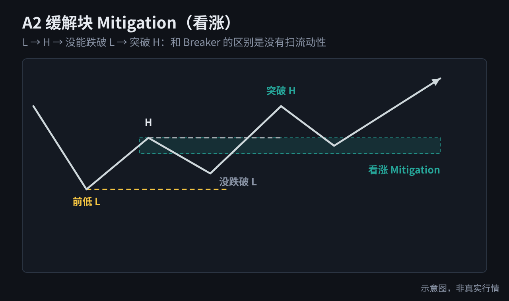

**一句话**：和 Breaker 很像，区别是**没有扫流动性**。

- Breaker：从 H 下跌时**跌破了前低 L**（扫了流动性），再突破 H
- Mitigation：从 H 下跌时**没能跌破 L**（形成更高的低点，属于"失败摆动"），然后突破 H

Mitigation 说明下跌方连扫流动性的力气都没有了。它的强度一般被认为不如 Breaker，因为少了"扫完流动性"这层证据。

### A3. 反转 FVG（IFVG）与平衡价区（BPR）

**IFVG（Inversion FVG）**：一个 FVG 被价格**实体收盘穿过**后，作用反转。例如原本的看涨 FVG 被跌穿，之后价格反弹回到这里，它可能变成压力。
- 判断关键：必须是**实体收盘**穿过，影线刺穿不算

**BPR（Balanced Price Range）**：一个看涨 FVG 和一个看跌 FVG 在价格上**重叠**，重叠的那段就是 BPR。两次快速走势都经过这里，被视为更敏感的反应区。

### A4. 最佳入场区（OTE）

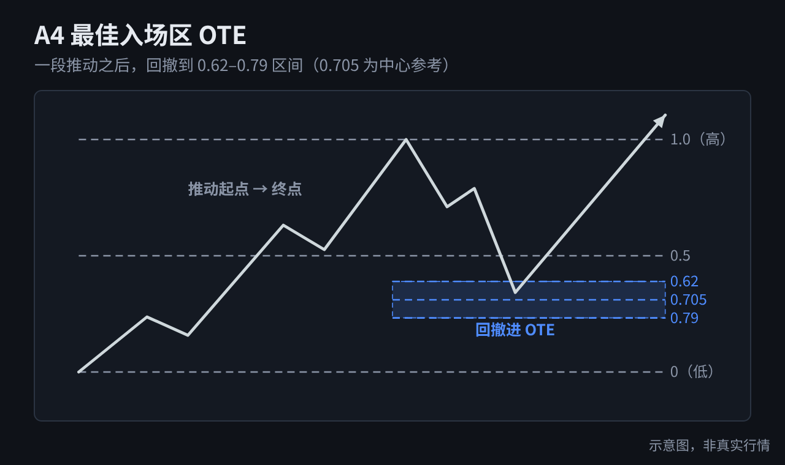

**一句话**：在一段有效推动之后，回撤到 **0.62–0.79** 斐波那契区间时，被视为位置更好的入场区；0.705 常被当作中心参考。

**怎么画**（多头）：从推动的起点（低点）拉到终点（高点），看回撤落在 0.62–0.79 之间。

**和 Premium / Discount 的关系**：OTE 在 Discount 区的深处（0.5 以下），本质是"在便宜区里找更便宜的位置"。

**注意**：OTE 只是位置过滤，不是入场信号。到了 OTE 仍然要等节奏（反应 K 线、小级别 CHoCH）。

### A5. 强高 / 弱高、强低 / 弱低

- **强低（Strong Low）**：造成向上 BOS 的那个低点。价格跌破它，上涨结构就失效了，所以它是多头要**保护**的点
- **弱高（Weak High）**：上涨中还没被突破、后续很可能被拿走的高点，是**目标**
- 下跌结构镜像：强高被保护，弱低是目标

**用法**：止损放在强点之外，目标看弱点。这和"止损基于结构、目标看对侧流动性"是同一件事的另一种说法。

### A6. 内部流动性与外部流动性（IRL / ERL）

- **ERL（External Range Liquidity）**：区间外侧的流动性，即摆动高点上方、摆动低点下方的止损池
- **IRL（Internal Range Liquidity）**：区间内部的流动性，主要指 FVG 等失衡区域

**节奏**：价格常在两者之间轮动：扫完 ERL → 回到 IRL（回补 FVG）→ 再去下一个 ERL。

**用法**：刚扫完外部流动性，下一步多半先回 FVG；刚回补完 FVG，下一步多半去扫外部流动性。

### A7. 时段与 Killzone

ICT 体系认为，不同交易时段的波动特征不同。以下用**纽约时间**表示（北京时间约 +12 小时，美国冬令时 +13 小时）：

| 时段 | 纽约时间（约） | 常见特征 |
|---|---|---|
| 亚洲时段 | 20:00–00:00 | 波动较小，常形成区间，高低点成为后续的流动性目标 |
| 伦敦 Killzone | 02:00–05:00 | 常先扫亚洲区间的一侧，再走出当日方向 |
| 纽约 Killzone | 07:00–10:00 | 波动最大，常延续或反转伦敦的走势 |

**注意**：不同教材给的时间段略有差异；这些主要基于外汇和美股指数的经验，加密市场 24 小时交易，时段效应较弱，只能参考。

### A8. PO3 / AMD（三段式）

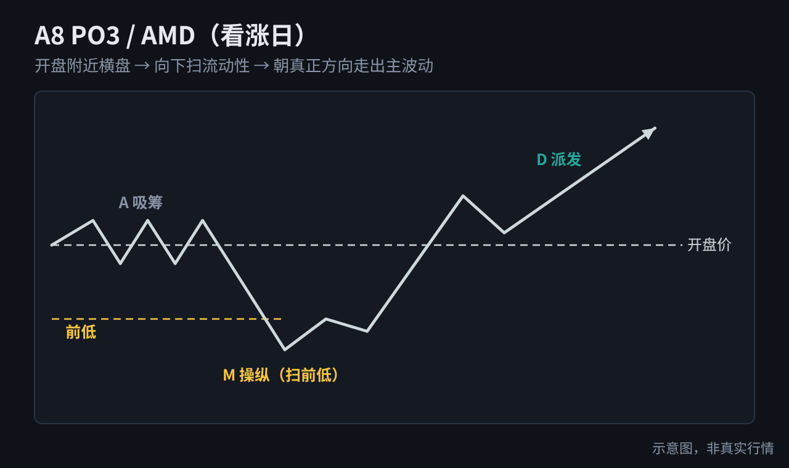

**PO3（Power of Three）**，也叫 **AMD**：一个周期（常用日线）里，价格常经历三段：

1. **Accumulation（吸筹）**：开盘附近横盘
2. **Manipulation（操纵）**：向**反方向**假突破，扫掉一侧流动性
3. **Distribution（派发）**：朝真正的方向走出主要波动

**例子**（看涨日）：开盘后先跌破开盘价、扫掉前低，然后大幅上涨，收在高位。

**和 SMC 的关系**：第 2 段就是"清扫"，第 3 段就是"位移"。PO3 只是把"扫 → 位移"放进了一个时间框架里看。

### A9. SMT 背离

**一句话**：两个**高度相关**的品种，一个创了新低（或新高），另一个没有。

- 例子：EURUSD 创新低，GBPUSD 没有创新低 → 下方的新低更可能只是一次扫流动性，而不是真跌
- 常见配对：EURUSD / GBPUSD、纳指 / 标普、BTC / ETH

**用法**：作为"清扫 vs 真突破"的额外证据，不单独作为入场信号。

---

## B. QM / 供需入场模型图鉴

> 出处：模型清单参考网络流传的《ICT 机构价格行为备忘单》（TRADER_ZHAO 整理），文字全部重写、示意图全部重画；"在 SMC 里对应什么"为作者的解读

### B0. 先建立对应关系

这一派的核心工具是**供应区（Supply）**和**需求区（Demand）**，以及**QML（QM Level，卡西莫多线）**。用 SMC 的语言翻译：

| 这一派的说法 | SMC 里对应的概念 |
|---|---|
| 供应区 / 需求区 | 订单区 OB / POI |
| QM（卡西莫多） | 扫高（或扫低）+ CHoCH + 回测左肩 |
| Fakeout（假突破） | 流动性清扫 |
| 2R / 2S（两次触碰同一阻力 / 支撑） | 等高 / 等低（流动性堆积） |
| SR Flip（支撑阻力互换） | 结构突破后的角色转换，类似 Breaker |
| Compression（压缩） | 人为制造的流动性 / 诱导 |
| Flag Limit | 造成突破的那段基底，类似 OB |

**所有模型都描述看跌版本**；看涨版本把图上下翻转即可。图例：H = 高点，L = 低点，HH = 更高的高点，LL = 更低的低点，R = 阻力，S = 支撑，LQ = 流动性。

---

### B1. QM 基础形态（卡西莫多）


**结构**：H → L → **HH**（创新高）→ **LL**（跌破 L）

- HH 扫掉了 H 上方的流动性
- LL 跌破了 L，结构转向（相当于 CHoCH）
- **QML** = 左肩 H 的水平线。价格反弹回到 QML 附近（QML 到 HH 之间）时，是观察做空的区域

```
            HH
            /\
     H     /  \
  - -/\- -/- - \- - - - - - QML (sell zone above)
    /  \ /      \
   /    L        \    /\
                  \  /  \
                   LL    \
```

**要点**：
- HH 必须是"扫高后回落"，LL 必须是实体收盘跌破 L
- 区域在 QML 和 HH 之间，不要只盯一条线

### B2. QM 快速回测 vs 延迟回测

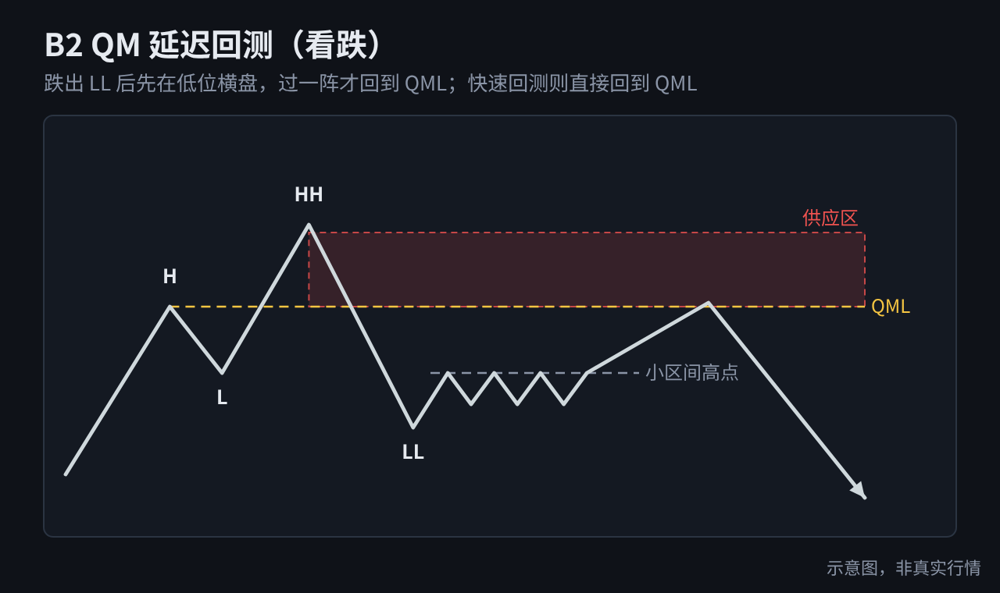

- **快速回测（Quick Retest）**：跌出 LL 后，**直接**反弹回 QML
- **延迟回测（Late Retest）**：跌出 LL 后先在低位**横盘一段**，形成小区间，过一阵才回到 QML

**区别的意义**：延迟回测时，低位的小区间会堆积流动性，价格回到 QML 前常先扫掉这个小区间的高点。

### B3. 影线 QM（DM Shadow）

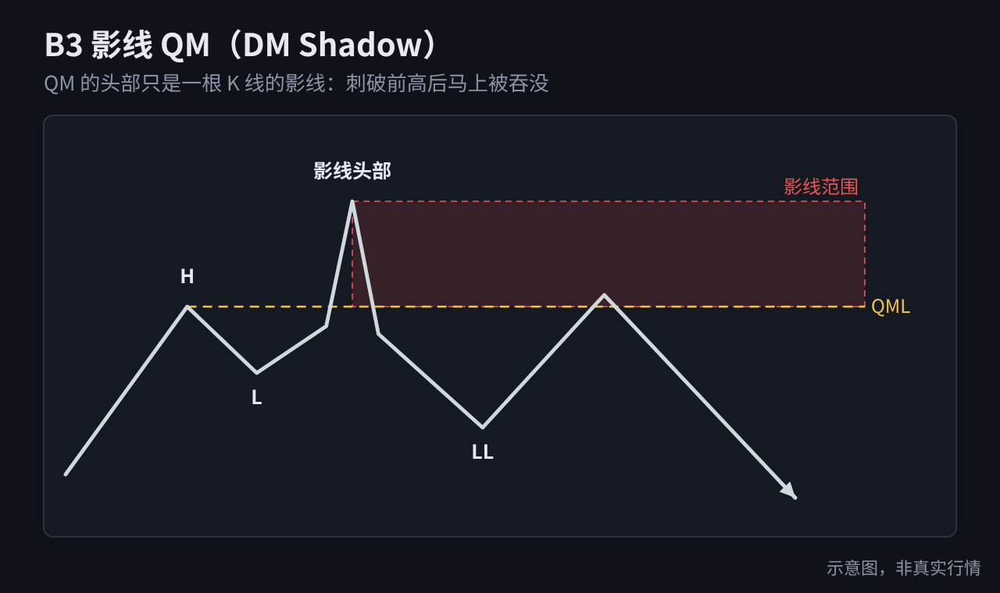

**结构**：QM 的头部（HH）只是**一根 K 线的影线**：价格快速刺破前高后马上被反向吞没。

**区域**：取那根刺破 K 线的影线范围作为供应区。

**和本教程口径的关系**：本教程的 OB 只取实体；影线 QM 是这一派专门用影线定义区域的特例，讲解时说明这一点。

### B4. 延续型 QM（Continuation QM）

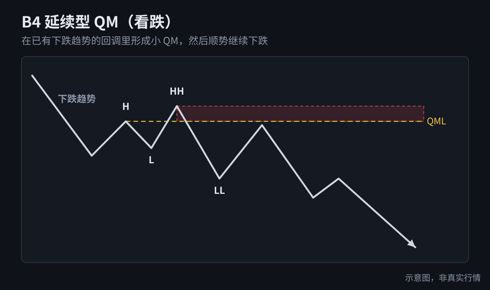

**结构**：在**已有的下跌趋势中**，回调时形成一个小 QM，然后继续下跌。

**意义**：QM 不只用于反转，也能用于趋势中的回调入场。对应 SMC 里"大方向不变，内部结构完成一次 CHoCH 后顺势入场"。

### B5. 双顶 / 双底假突破（2R / 2S Fakeout）

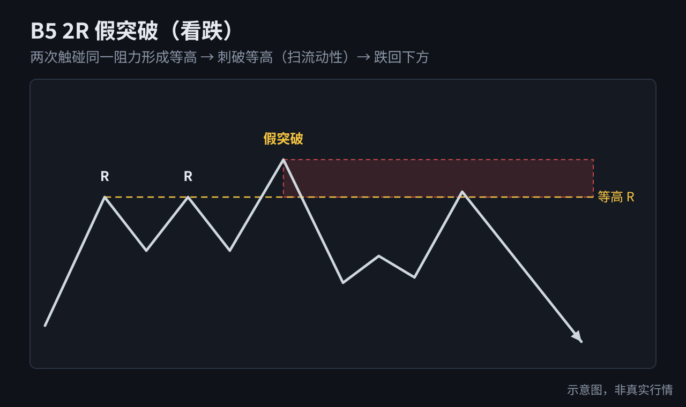

**结构**：价格两次触碰同一阻力（R、R），形成明显的等高 → 第三次**刺破**等高（扫流动性）→ 迅速跌回下方

```
   R    R      fake
  /\   /\     /\
 /  \ /  \   /  \   <- sell zone (above the R level)
- - - - - - -/- - \- - - - -
        \  /       \
         \/         \
```

**对应**：就是 SMC 的"等高被扫"。越明显的双顶，越容易被扫。

### B6. QM 再入场（Re-entry：主 QML 与小 QML）

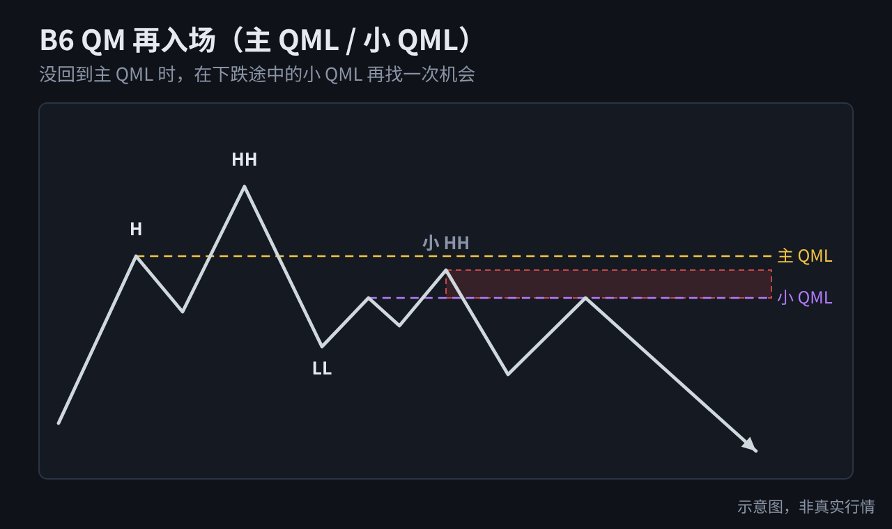

**结构**：一个大 QM 形成后，在下跌途中又出现一个**小 QM**。
- **主 QML**：大结构的 QML
- **小 QML**：下跌途中形成的小 QML

**用法**：如果价格没回到主 QML，可以在小 QML 再找一次入场机会；小 QML 离主 QML 越近，参考价值越高。

### B7. 被忽略的 QM（Ignored QM，IQML）

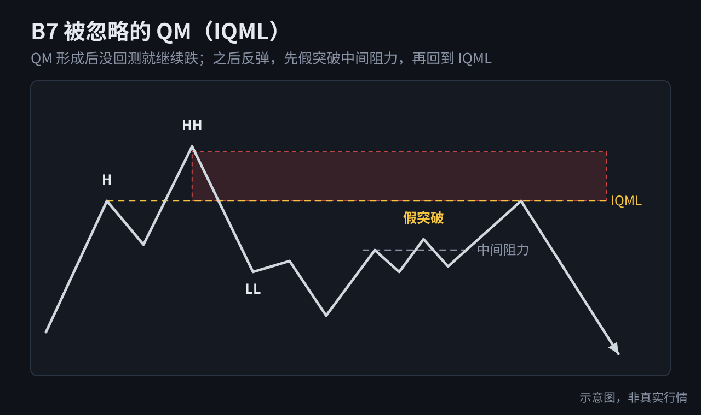

**结构**：QM 形成后，价格**没有回测**QML 就继续下跌，这个 QML 被"忽略"了。之后价格反弹，在到达 IQML 之前，常会先在中间某个水平做一次假突破（扫掉中间的阻力），再回到 IQML。

**用法**：被忽略的 QML 不等于失效。等价格回来，并留意它到达前的那次假突破。

### B8. 统治者（Ruler）

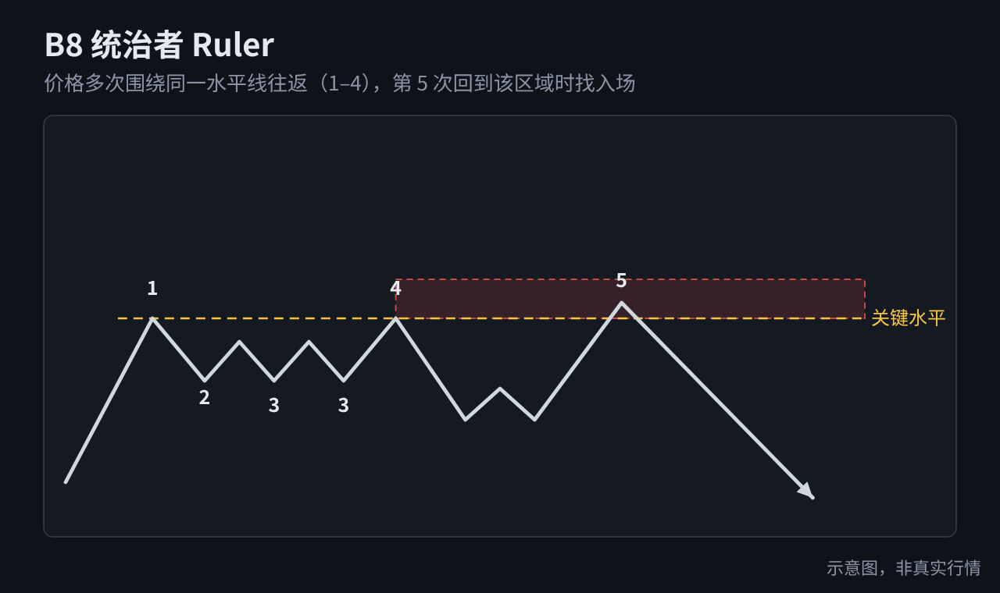

**结构**：价格多次围绕**同一条水平线**来回（图上依次标为 1、2、3、3、4），这条线反复起作用；之后价格离开，再第 5 次回到该区域时找入场。

**意义**：一条被反复验证的水平线，周围堆积了大量订单和止损。第 5 次回来时，相当于回测一个"被市场反复确认过的"供需区。

### B9. V 型双底 / 双顶（V Twin）

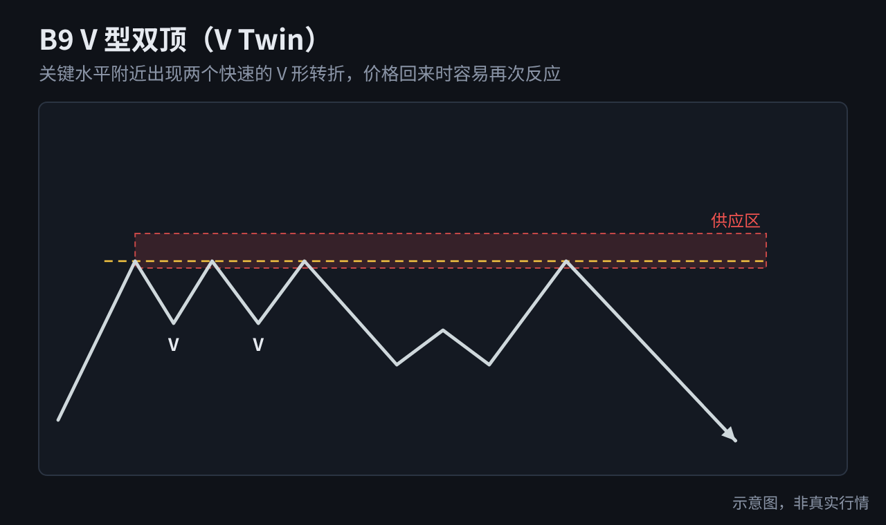

**结构**：在关键水平附近出现**两个 V 形转折**（快速下探后快速拉回），供应 / 需求区画在 V 的位置。

**意义**：快速的 V 形说明这里有大量挂单被成交，价格回来时容易再次反应。

### B10. 旗形限制（Flag Limit / Flag B）

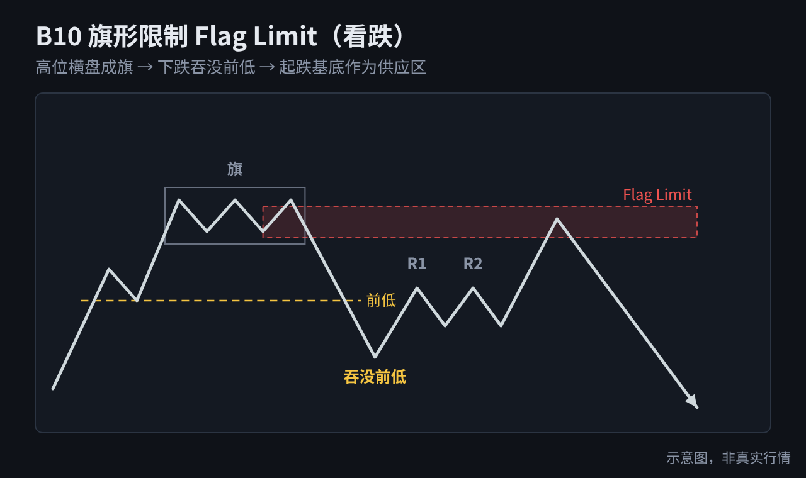

**结构**（看跌）：
1. 价格在高位横盘，形成一个"旗"
2. 一段下跌**吞没了前低**（Engulf Previous Low）
3. 造成这次吞没的那段起跌基底，就是 **Flag Limit**，作为供应区
4. 价格反弹回 Flag Limit 时找空，途中常出现 R1、R2 两个小阻力

```
   ___________
  |  flag     |  <- Flag Limit (supply)
  |  /\/\/\   |
  |_/_____\___|    R1  R2
          \      /\  /\
           \    /  \/  \
 prev low - \- / - - - -\- -
             \/          \
          (engulf)
```

**对应**：Flag Limit 本质上就是"造成位移、吞没前低"的 OB。

### B11. 双旗形（Flag A + Flag B）

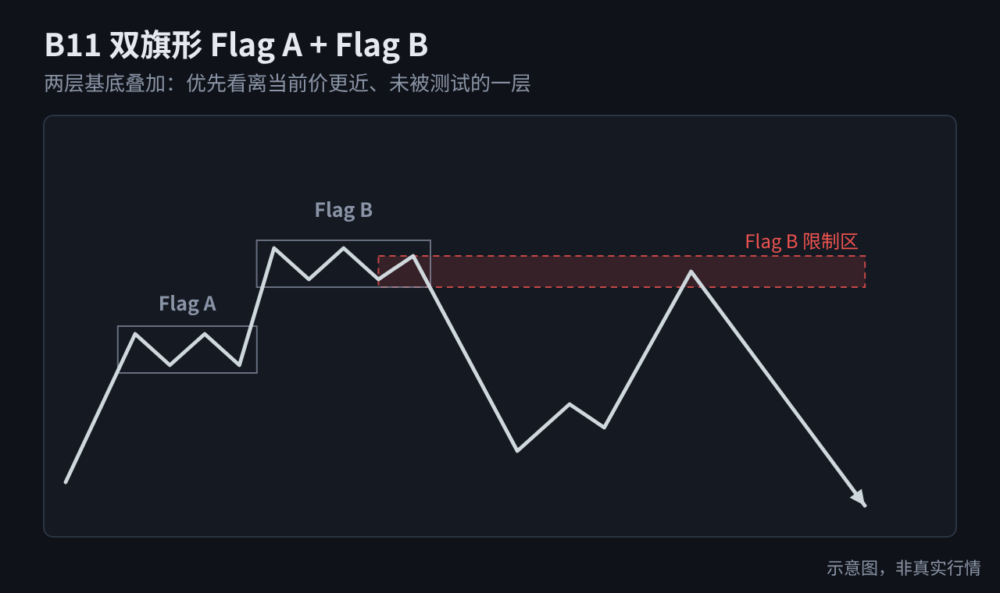

**结构**：先形成一个旗（Flag A），价格突破后又形成第二个旗（Flag B），第二个旗的限制区作为供应区。

**意义**：两层基底叠加，说明这一侧的订单很集中。实战中优先看离当前价更近、且未被测试过的那一层。

### B12. 默认假突破（Fakeout V1）

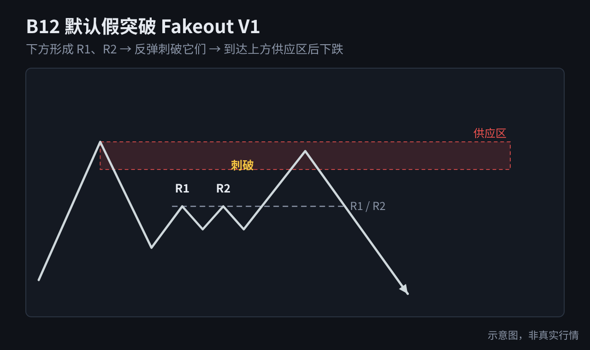

**结构**：一个高点后价格下跌，在下方形成两个较低的阻力 R1、R2 → 价格反弹，**刺破 R1 / R2** → 到达上方的供应区后下跌

**对应**：R1、R2 上方是流动性，价格先扫掉它们，才回到真正的供应区。也就是"先扫诱导，再到真区域"。

### B13. 支撑阻力互换假突破（Fakeout V2，SR Flip）

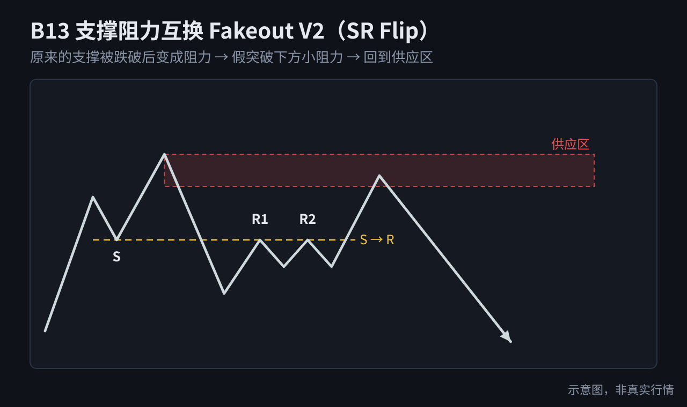

**结构**：原来的支撑 S 被跌破后变成阻力（SR Flip）→ 价格在这个阻力下方形成 R1、R2 → 假突破这些阻力，到达上方供应区后下跌

**对应**：SR Flip 和 Breaker 的逻辑相同：原来在这里买入的人被套，价格回到成本附近时选择平仓，形成压力。

### B14. 钻石假突破（Fakeout V3，Diamond）

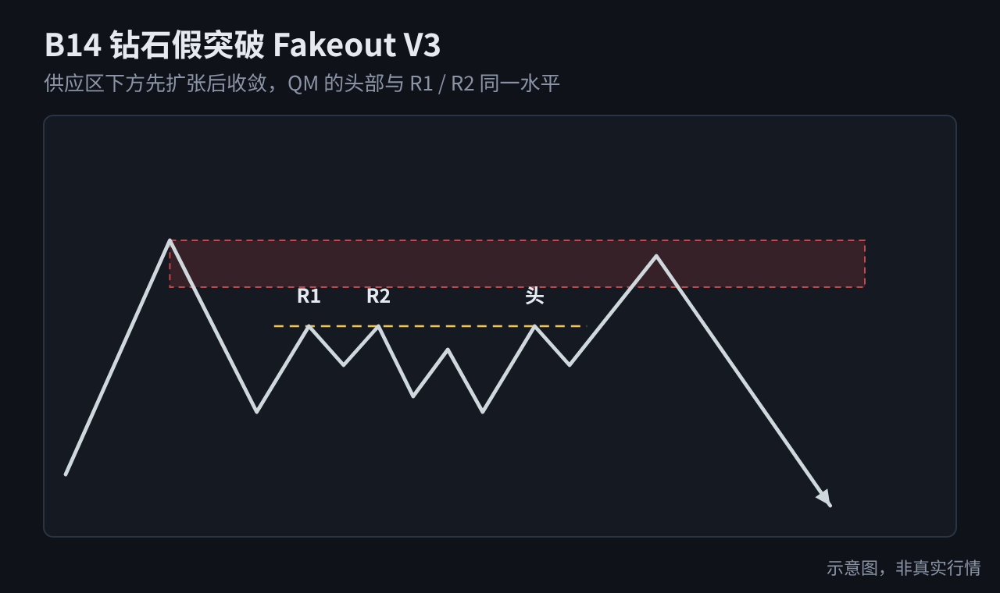

**结构**：在供应区下方，价格走出一个类似钻石的收敛形态（先扩张后收敛），**QM 的头部和前面的 R1 / R2 处在同一水平**，然后向下突破。

**要点**：头部与前面的阻力位在同一水平，是识别它的关键。

### B15. 最大痛苦位（MPL，Maximum Pain Level）

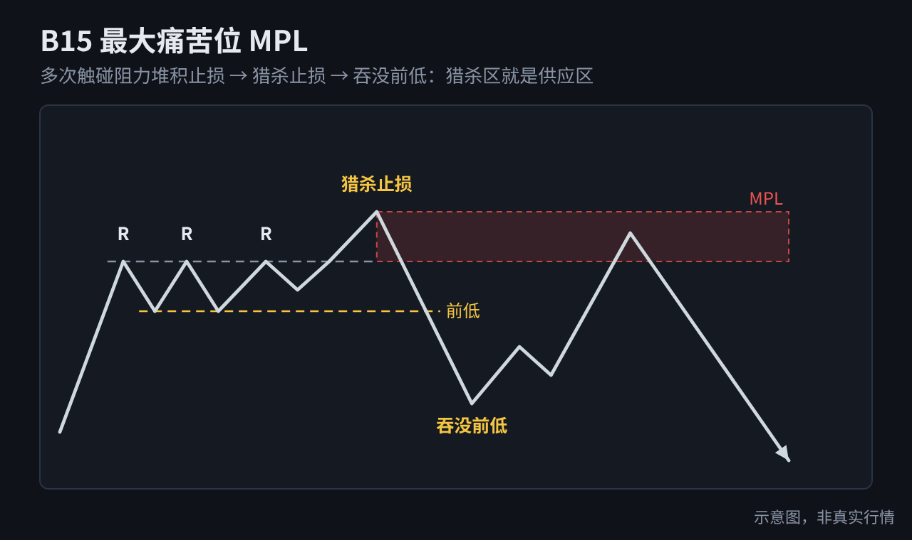

**结构**：
1. 价格在阻力附近多次触碰（R、R），堆积止损
2. 一次**猎杀止损**（Stop Hunt）刺破这些阻力
3. 随后一段下跌**吞没前低**
4. 猎杀止损的那个区域，就是 MPL 供应区

**对应**：MPL ≈ 扫掉等高 + 位移跌破结构后的 OB。名字的意思是：在这里追多的人"最痛"。

### B16. 双重支撑阻力（Double SSR）

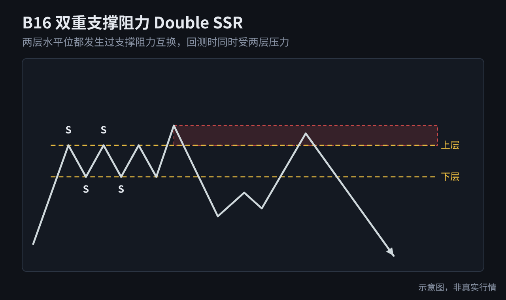

**结构**：图上有**两层**水平位（上层、下层），各自都发生过支撑阻力互换。价格先失守下层，回测时同时受到两层的压力。

**意义**：两层压力叠加，比单层更可靠；但也意味着突破后需要更大的力量。

### B17. 三推（3 Drive）

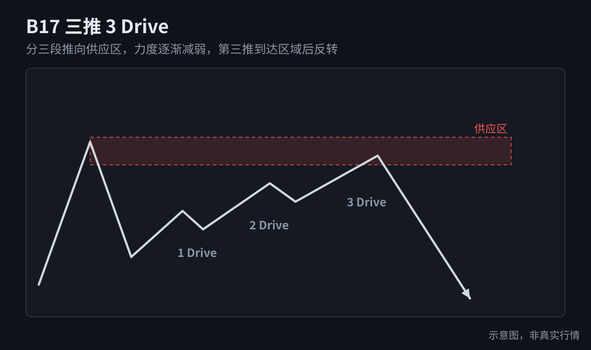

**结构**：价格分**三段**推向供应区（1 Drive、2 Drive、3 Drive），每一段的力度逐渐减弱，第三推到达区域后反转

```
                      3 ____ supply
              2      /
       1     /\     /
      /\    /  \   /
     /  \  /    \ /
    /    \/      v
```

**意义**：力度递减，说明推动方越来越没力气；同时每一段的回调低点都在堆积流动性，反转后会被一路扫掉。

### B18. 反复敲打（CAN CAN）

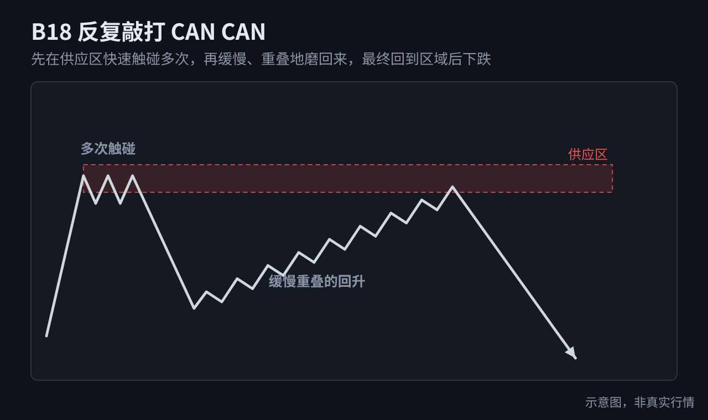

**结构**：价格先在供应区**快速触碰多次**（像敲罐子），然后长时间、小幅度地下跌又慢慢磨回来（很多细小的波浪），最终再次回到供应区并下跌。

**意义**：缓慢、重叠的回升没有力度，是在"慢慢走回去"而不是"打上去"，所以回到区域时更容易被压回。

### B19. 压缩（Compression，CP）

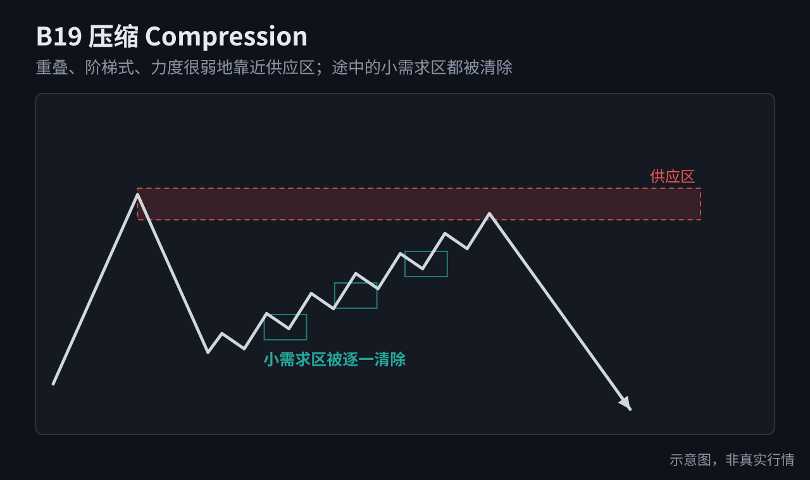

**结构**：价格以**重叠、阶梯式、力度很弱**的方式靠近供应区；途中形成的每一个小需求区，都被后面的价格清除（Demand Clear）。

```
                 ________ supply
                |________|
              /\/
           /\/      <- each small demand gets cleared
        /\/
     /\/
    /
```

**对应**：压缩就是 SMC 里人为制造的流动性 / 诱导：一路向上的小低点下面全是多头止损，反转时会被一次性扫掉，所以反转往往很快。

### B20. 压缩流动性（CPLQ）与 CAN CAN 假突破

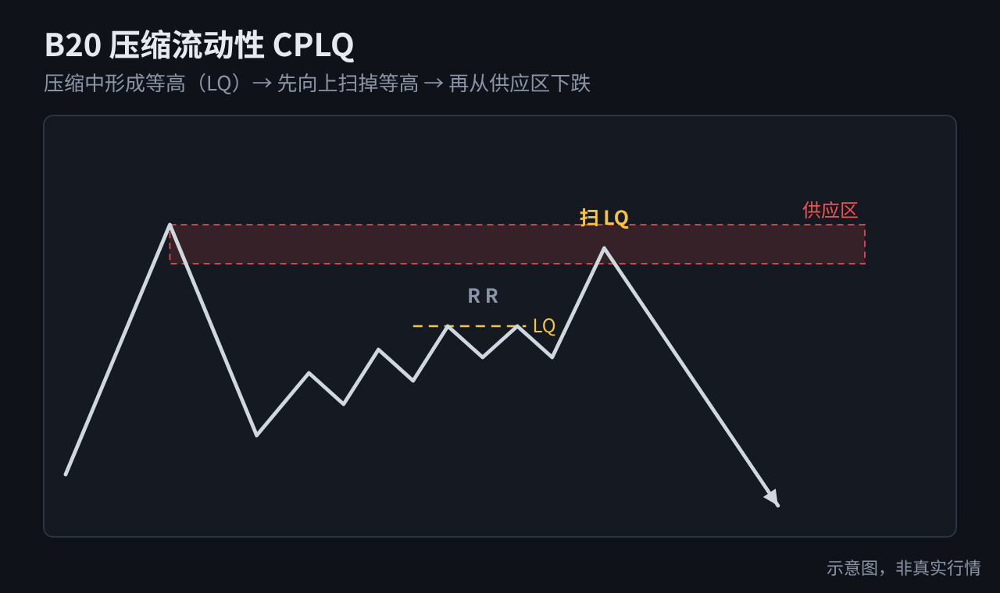

- **CPLQ（Compression Liquidity）**：压缩过程中形成了明显的 R、R（等高），价格先向上**扫掉这些等高（LQ）**，再从供应区下跌
- **CAN CAN + Fakeout**：CAN CAN 式的缓慢回升，最后一冲**越过供应区**扫掉上方流动性（假供应），然后下跌

**共同点**：区域本身不是终点，区域**上方的流动性**才是。价格先扫流动性，再反转。

---

## C. 学这些模型的正确姿势

1. **先认概念，再认形态**：每个模型都能拆成"流动性 + 结构 + 区域"三件事。拆不出来，说明还没看懂
2. **名字不重要**：同一种走势，不同教材可能叫不同的名字。能说清"谁的止损在哪、谁被套、价格为什么回来"才重要
3. **形态不等于信号**：所有模型都只是告诉你"在哪里等"，入场仍然要等节奏（反应 K 线、小级别 CHoCH）
4. **不要贪多**：挑 2–3 个最容易识别的（建议 QM、2R/2S 假突破、Flag Limit），在自己的图上回看 50 次以上，再考虑加新的


---

仅供学习交流，不构成任何投资建议。所有示意图为程序生成的虚构走势，非真实行情。
