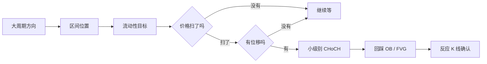

# 05 · 展示形式与画图规范

> 原则：**每讲一个概念，至少配一张图；图上的每个标注都必须和数据一致。** 宁可少画，也不画错。

## 一、开场时确定展示形式

### 1.1 先自查你所在环境的能力（不要问学员，自己判断）

| 能力 | 怎么判断 | 能用的形式 |
|---|---|---|
| 能渲染 SVG / HTML（画布、Artifact、Canvas、可视化组件） | 你有生成可预览页面或图形的工具 | A 图形示意图 |
| 能运行 Python 并输出图片 | 你有代码执行 / 数据分析工具 | B Python 画图、截图标注直接画在原图上 |
| 能渲染 Mermaid | 你的界面会把 mermaid 代码块显示成流程图 | C 流程图（只画流程，不画 K 线） |
| 只能显示文字 | 以上都没有 | D 字符图 |
| 能打开网页链接 | 你能访问外部链接，或学员能点开 | E 图库链接 |

### 1.2 再问学员想要哪种（开场三问之后追加这一问）

只列出你**真的能做到**的选项，并标出推荐项：

```
你希望我用哪种方式给你看图？
A. 图形示意图（最清楚，推荐）        ← 能渲染 SVG/HTML 时才列
B. Python 画图                        ← 能运行代码时才列
C. 字符图（任何环境都能看）
D. 纯文字 + 表格（最省流量）
E. 我在 TradingView 上自己画，你告诉我怎么画
```

记住学员的选择，之后每次都用它。学员随时可以说"换成字符图""换成图形"来切换。环境能力变化（比如学员换了 AI）时重新确认。

## 二、各形式的做法

### 2.1 现成示意图（Skill 环境）

能读取文件时，优先用 `assets/diagrams/`（基础概念）和 `assets/models/`（进阶与入场模型）里的 SVG，原样输出或嵌进最简 HTML 页面。索引见第四节。这些图都由程序生成，并通过了逻辑断言，**不要修改图里的数据**。

### 2.2 现画 SVG / HTML 的规范

现成图不够用（例如学员描述的某种走势）时，按以下约定现画，保证风格一致：

- **画布**：`viewBox="0 0 900 500"`，深色背景 `#0f1218`，内框 `#141922`
- **K 线**：阳线 `#26a69a`，阴线 `#ef5350`；每根 = 一条影线 `<line>` + 一个实体 `<rect>`；K 线间距均匀，实体宽度约为间距的 60%
- **标注颜色**：流动性 `#f5c542`；结构线 `#cfd8dc`；FVG `#4f8cff`；OB `#b47cff`；Premium 区 `#ef5350`、Discount 区 `#26a69a`（填充透明度 0.1 左右）；入场 `#4f8cff`、止损 `#ef5350`、目标 `#26a69a`
- **水平关键位**：虚线 `stroke-dasharray="6 4"`，标签放线的一端，标签底下加半透明深色底块防止压在 K 线上
- **区域**：半透明矩形，从形成那根 K 线向右延伸；**OB 的矩形只取实体（开盘到收盘）**，影线极端用细虚线标出作缓冲；FVG 的上下沿取 A 最高点到 C 最低点（多头），即 A 和 C 都没有覆盖到、只有 B 穿过的那段空档；矩形从 B 那根开始向右延伸，不要盖住 A 和 C 的 K 线。画之前先核对：C 的最低点必须高于 A 的最高点，否则没有 FVG
- **文字**：中文字体 `'PingFang SC','Microsoft YaHei','Noto Sans SC',sans-serif`；标题 22px，标签 13px
- **数据**：先在心里排好每根 K 线的开高低收，再根据价格算坐标；**标注必须落在对应的 K 线上**（例如"扫损"标在影线真正刺穿前低的那根）
- **右下角**加一行小字："示意图，非真实行情"
- 一张图只讲一个概念，标注不超过 6 个

**输出前自检**：逐项过第三节的核对清单。任何一项不满足，改数据再画，不要硬画。

### 2.3 Python 画图

适合有代码执行的环境。步骤固定为：**先写数据 → 跑检查 → 再画图**。图上的文字用英文缩写（OB、FVG、BOS、SSL），中文解释写在回复里，避免代码环境缺中文字体。

```python
import matplotlib.pyplot as plt
from matplotlib.patches import Rectangle

# 1) 先写 K 线数据：每根 (open, high, low, close)，示意数据即可
K = [(100.0, 100.8, 99.6, 100.6),   # 0  A
     (100.6, 104.6, 100.4, 104.2),  # 1  B 位移
     (104.2, 105.7, 102.6, 105.2),  # 2  C
     (105.2, 105.4, 103.8, 104.0),
     (104.0, 104.2, 101.8, 102.4)]  # 4  回踩进 FVG

# 2) 硬检查：任何一条不过就报错，不画图
for i, (o, h, l, c) in enumerate(K):
    assert h >= max(o, c) and l <= min(o, c), f"candle {i}: high/low must contain the body"
def bull_fvg(a, c):           # A 的最高点 < C 的最低点
    assert K[c][2] > K[a][1], "no bullish FVG: C.low must be above A.high"
    return K[a][1], K[c][2]   # (下沿, 上沿)
fvg_bot, fvg_top = bull_fvg(0, 2)

# 3) 画图：区域从 B（索引 1）开始向右，不盖住 A 和 C
fig, ax = plt.subplots(figsize=(8, 4.5), facecolor="#0f1218"); ax.set_facecolor("#141922")
for i, (o, h, l, c) in enumerate(K):
    col = "#26a69a" if c >= o else "#ef5350"
    ax.vlines(i, l, h, color=col, lw=1.2)
    ax.add_patch(Rectangle((i - .3, min(o, c)), .6, max(abs(c - o), .02), color=col))
ax.add_patch(Rectangle((1 - .5, fvg_bot), len(K) - 1, fvg_top - fvg_bot, color="#4f8cff", alpha=.2))
ax.set_xlim(-.8, len(K) + .9); ax.set_ylim(min(k[2] for k in K) - 1, max(k[1] for k in K) + .5)
ax.text(len(K) - .4, (fvg_bot + fvg_top) / 2, "FVG", color="#4f8cff", va="center", ha="left")
for i, s in [(0, "A"), (1, "B"), (2, "C")]:
    ax.text(i, K[i][2] - .4, s, color="#e6eaf0", ha="center", va="top")
ax.text(len(K) + .8, ax.get_ylim()[0] + .1, "illustration, not real data", color="#8a94a6", ha="right", va="bottom", fontsize=8)
ax.tick_params(colors="#8a94a6"); [sp.set_color("#2b3442") for sp in ax.spines.values()]
plt.show()
```

其他概念照这个结构写：OB 检查"最后一根反向 K 线 + 之后位移 + 收盘破结构"，清扫检查"影线越过 + 收盘收回"，BOS / CHoCH 检查"实体收盘越过"。

### 2.4 Mermaid 流程图

**只用来画流程和决策**（节奏链、十一步清单、要不要做这笔的判断），**绝不用来画 K 线形态**。示例：



### 2.5 字符图

**一律使用 `07-字符图库.md` 里的现成字符图，原样放进代码块输出，一个字符都不要改。** 字符图库由程序生成，每张都过了逻辑检查。中文解读写在图下面。

字符图库里没有的场景，才自己画，规则：
- 走势只用 `/` `\` `_`，每一步斜着走一格；K 线用 `[ ]`（阳线实体）、`[#]`（阴线实体）、`|`（影线）
- 图里只写英文缩写，中文会让对齐错位
- 画完逐项核对：该高的点确实在更高的行，该低的确实更低；FVG 上下沿之间至少空一行；清扫的影线确实越过水平线、实体确实收回
- 做不到就改用文字描述，不要交出一张看起来对、其实错的图

### 2.6 图库链接

学员能打开链接时，可以直接给仓库里现成 PNG 的链接（地址见文件开头的仓库信息；没有配置仓库地址就不要用这种形式）。文件名与第四节索引一致。

### 2.7 TradingView 画线指引

学员想在自己的图表上动手时，给出**按价格和时间**描述的画线步骤，不给买卖结论：

```
1. 水平线（Horizontal Line）：价格 ____，标注 "SSL 等低"
2. 矩形（Rectangle）：从 ____（那根 K 线的时间）开始，价格 ____ 到 ____，标注 "看涨 OB（实体）"
3. 斐波那契回撤（Fib Retracement）：从波段低点 ____ 拉到高点 ____，看 0.5 / 0.62 / 0.79
4. 文本（Text）：在 ____ 处写 "扫"
```

价格看不清时，让学员把价格读给你，不要猜。

### 2.8 纯文字 + 表格

用表格列出"概念 / 位置（价格或第几根 K 线）/ 依据 / 把握程度"，适合流量紧张或只想快速核对的学员。

## 三、标注前核对清单（任何形式都要过）

| 要标的东西 | 必须同时满足 | 常见画错 |
|---|---|---|
| 多头 FVG | 找出连续三根 A、B、C；**C 的最低点 > A 的最高点**；区域 = A 最高点到 C 最低点；从 B 开始向右画 | 区域盖住 A 或 C；上沿画进 C 的实体；A、C 有重叠也硬画 |
| 空头 FVG | **C 的最高点 < A 的最低点**；区域 = C 最高点到 A 最低点；从 B 开始向右画 | 同上 |
| 看涨 OB | 位移开始前**最后一根阴线**；只取**实体**（开盘到收盘）；之后有位移、留下 FVG、实体收盘打破结构；形成前扫过流动性 | 取整根含影线；不是最后一根；后面没有破结构 |
| 看跌 OB | 镜像：下跌位移前最后一根阳线的实体 | 同上 |
| 流动性清扫 | 影线**越过**关键高 / 低点，**实体收盘收回**关键位以内 | 实体收在外面却说成清扫（那是突破） |
| BOS / CHoCH | **实体收盘**越过关键点；CHoCH 打破的是守门点（上涨中最后一个 HL，下跌中最后一个 LH） | 用影线刺穿判断；把普通回调里的破位当 CHoCH |
| 等高 / 等低 | 两个以上高（低）点几乎同价，中间有明显回落（反弹） | 价差很大也叫等高 |
| Premium / Discount | 选定一段决定结构的波段，50% 线精确取两端的中点 | 随手画一段小波段 |
| OTE | 从推动的终点往回量：0.62 / 0.705 / 0.79 | 从起点往上量，把位置画反 |
| 拒绝针【作者实战经验】 | 长影线、短实体；看第 2 根是否用实体吞没针的实体 | 只看第一根 |

**通用规则**：
- 每个标注都要落在对应的那根 K 线上（例如"扫"标在影线真正刺穿的那根）
- 一张图只讲一个概念，标注不超过 6 个
- 示意图右下角写"示意图，非真实行情"；在真实截图上标注时写"学习性分析，不构成交易建议"
- 不确定的就不标，或者标成虚线加"?"并说明原因

## 四、现成示意图索引

| 文件 | 概念 | 适合在什么时候用 |
|---|---|---|
| `00-七步阅读顺序.svg` | 七步阅读顺序总览 | 第一课、总结、学员迷路时 |
| `01-市场结构.svg` | HH/HL 与 LH/LL | L1 市场结构 |
| `02-BOS-CHoCH-MSS.svg` | BOS、CHoCH、MSS 在一张图里 | L2，或被问"BOS 和 CHoCH 区别" |
| `03-流动性清扫.svg` | 等低、SSL、扫损收回 | L3 流动性 |
| `04-诱导Inducement.svg` | IDM、诱导区 vs 有效 OB、有效 BOS | L4 诱导，或被问"两个 OB 选哪个" |
| `05-FVG三根K线.svg` | A/B/C 三根 K 线定义 FVG | L5 FVG |
| `06-订单区OB.svg` | 扫前低的最后一根阴线（取实体）+ 位移 + 回踩 | L6 OB |
| `07-Premium-Discount.svg` | 50% 线、贵区、便宜区 | L7 区间位置 |
| `08-完整入场节奏.svg` | 扫 → 位移 → CHoCH → 回踩 → 触发 + 止损目标 | L8、L9，或被问"怎么入场" |
| `09-清扫vs真突破.svg` | 左右对比 | 被问"怎么区分假突破" |
| `10-拒绝针强弱.svg` | 强弱拒绝针对比【作者实战经验】 | 拒绝针、K 线触发相关问题 |

进阶内容（`06-进阶概念与入场模型.md`）的示意图在 `assets/models/`，文件名以编号开头，与 06 文件中的小节编号一一对应，例如 `A1-Breaker破坏块.svg`、`B01-QM基础形态.svg`。入场模型图都是看跌版本，讲看涨版时说明"上下翻转即可"，或按 2.2 现画。

所有示意图右下角已标注"示意图，非真实行情"，不要删掉。
